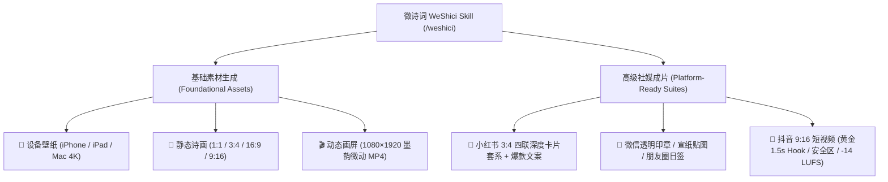
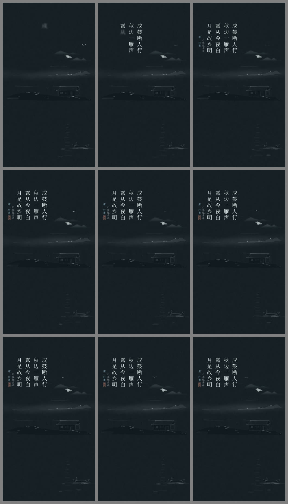
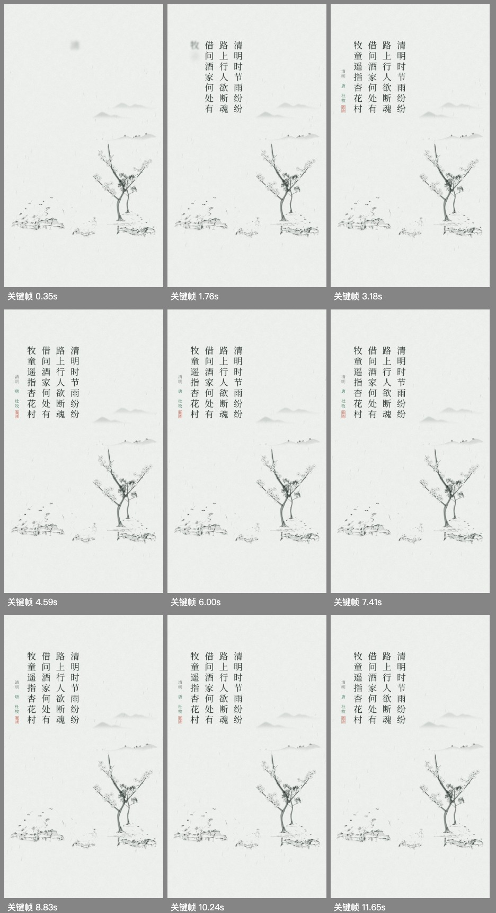
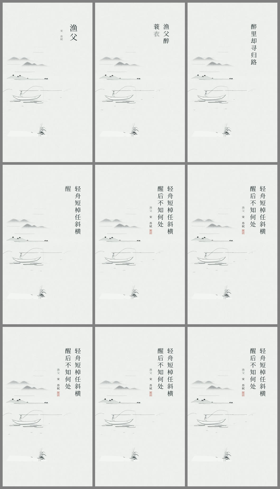
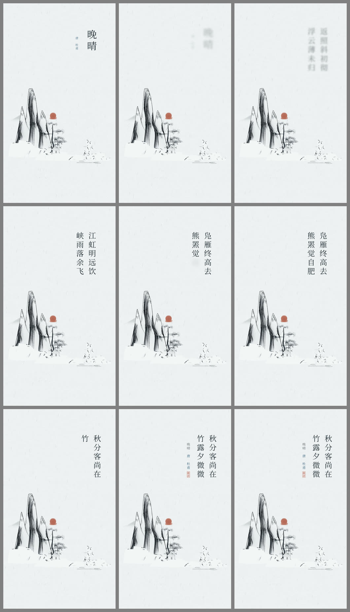
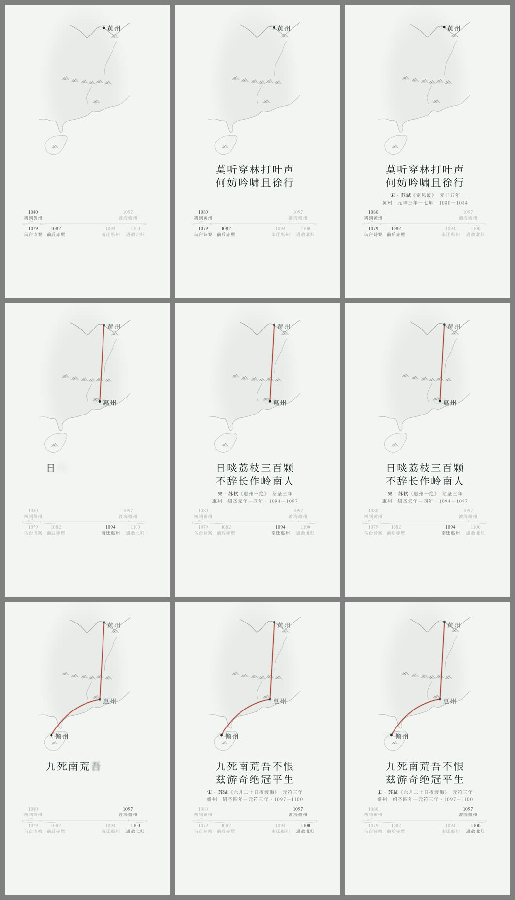
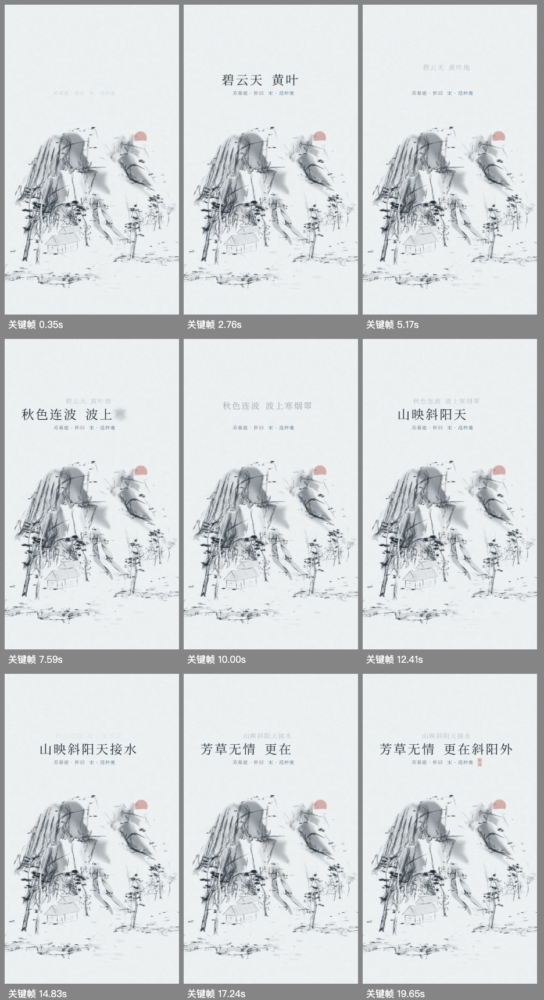

# 微诗词 · WeShici Skill (`/weshici`)

[](./SKILL.md)
[](./SKILL.md)
[](https://github.com/charsunny/zixiao-kit)
[](./LICENSE)

**微诗词（WeShici Skill，快捷指令 `/weshici`）** 是以 **Agent Skill 为主体** 封装的中国古典诗词、二十四节气画屏与东方水墨美学确定性视觉与短视频制片引擎。

本技能遵循标准 Agent Skill 规范（包含 [`SKILL.md`](./SKILL.md)、[`references/`](./references/)、[`scripts/`](./scripts/)、[`resources/`](./resources/) 与 [`examples/`](./examples/)），借鉴并深化了 [`lemomo-ai/lemo-opuscar`](https://github.com/lemomo-ai/lemo-opuscar) 的「将视频视为时间 $t$ 的纯函数 `window.render(t)` + 三层导演知识库」理念，深度结合 [子晓套件 `ZixiaoKit`](https://github.com/charsunny/zixiao-kit) 的 **ShanShui@5 Web 渲染快照**、中国传统色配色体系、真实人声词级对齐（Audio-First Cue Grid）和程序化东方拟音（古琴泛音、落墨、朱印闷响、宣纸翻页），彻底攻克通用生成式 AI 视频在汉字书法乱码、水墨留白失真与声画脱节上的痛点。

---

## Wish iOS 8.0.1 对齐

使用 Wish 同款画屏前，先读 [iOS 画屏实现基准](references/IOS-HUAPING.md)。本次按本机已提交的 8.0.1 代码更新 skill：五种画风与随诗意、字体继承和简繁缓存、锁屏留白、分享页脚、视频时间线及实况导出规则。

`image` / `wallpaper` 已按 App 的诗句框拟合字号、右起竖排、题名署名竖印和锁屏安全区排版，内置思源宋体和 App 印章。长题单独缩放，七言参考五言字号；放不下时按联摘句并输出提示。

`image` 页脚包含品牌、真实诗词入口码，以及二维码右侧的「公历日期 / 节气 · 候」。默认北京时间当天，`--date 2026-10-26` 可固定出图日期。

山水笔触、五画风和视频时间线仍有差异，也没有 Widget 与 Live Photo 配对导出；相同 seed 不保证跨端像素一致。

## ⚡ 斜杠指令唤起 (`/weshici`)

在各类 AI 编码助手或 Agent 对话框中，你可以随时键入 `/weshici` 进行快速制片：

```text
/weshici wallpaper <诗题> [诗句] [--device iphone|ipad|mac-4k] [--pure]
/weshici image <诗题> <诗句> [--ratio 3:4|1:1|16:9|9:16]
/weshici xiaohongshu <诗题> <诗句> [--author 作者]
/weshici wechat <词语/诗句> [--type seal|xuan|card]
/weshici douyin <诗题> [诗句]
/weshici produce <诗题/诗人> [--style huaping-motion|ink-story]
```

---

## 🌟 核心能力矩阵：双层制片体系

微诗词为 AI 助手及创作者提供 **「基础素材生成」** 与 **「高级社媒成片」** 两大维度的能力支持：



---

## 一、底层算法引擎升级：ZixiaoArt ShanShui@5

内置来自子晓开源套件 [`charsunny/zixiao-kit`](https://github.com/charsunny/zixiao-kit) 的程序化国画 Web 快照：

1. **宋元画理三远透视构图（Sanyuan Composition）**：
   - 严格继承北宋郭熙《林泉高致》之「高远」、「深远」、「平远」三大透视法。
   - 自动分层规划远岫烟峦（远景）、主峰叠嶂与古刹悬瀑（中景）、江岸矶头与古树舟桥（近景）。
2. **15 种经典诗意场景（Poetry Scenes）**：
   - `retreat`（山居林泉）、`fishing`（寒江独钓）、`waterTown`（江南水乡）、`farewell`（长亭送别）、`village`（田园村舍）、`spring`（春江花月）、`lotusPond`（荷塘清趣）、`autumnTravel`（秋山行旅）、`winterForest`（冬雪寒林）、`moonNight`（松风明月）、`temple`（古寺钟鸣）、`courtyard`（庭院深幽）、`historic`（故国怀古）、`desert`（边塞大漠）、`ocean`（沧海烟波）。
3. **48 种精妙写意母题与传统笔墨**：
   - 蟹爪树枝（`paintingWoodyTree`）、个字点/胡椒点/松针点（`paintingLeaves`）、三面折光山石（`paintingStone`）、墨分五色渲染（`PaintingStageV5`）。
4. **腰云锁翠 (`LayerFade`)**：
   - 基于 FBM 复合噪声与连续衰减函数模拟山腰云遮雾锁，云气自然融入宣纸底色，无突兀生硬的生硬边缘。
5. **双向锚点对齐与纯前端零原生依赖**：
   - 画面生成自动导出 `ridges`（山脊线）、`water`（水线）、`boats`（舟楫）、`trees`（树木）、`sky`（留白天光）等逻辑锚点坐标，完美指引字幕、题签与印章的避让与咬合。
   - 纯前端 Canvas / Web Worker 运行，跨平台完全确定性（Deterministic）。

---

## 二、命令行快速上手 (`scripts/generate.mjs`)

> 环境依赖：**Node.js >= 18**、本机安装有 **Google Chrome**（或指定 `CHROME_PATH`）与 **FFmpeg**。

```bash
git clone https://github.com/charsunny/weshici-skill.git
cd weshici-skill
npm install
```

### 1. 基础素材生成 (Foundational Assets)

#### 📱 高清设备壁纸 (`wallpaper`)
支持 iPhone Pro Max (`1290×2796`)、iPad Pro (`2048×2732`)、Mac 4K 超高清横屏 (`3840×2160`) 等规格：
```bash
# 生成 iPhone 锁屏壁纸 (题字闲章版)
npm run weshici -- wallpaper --title "山居秋暝" --poem "明月松间照，清泉石上流。" --device iphone

# 生成 Mac 4K 超清横屏壁纸 (纯山水无字留白版，为桌面图标留出空间)
npm run weshici -- wallpaper --title "使至塞上" --poem "大漠孤烟直，长河落日圆。" --device mac-4k --pure

# 生成 iPad Pro 竖屏壁纸
npm run weshici -- wallpaper --title "江雪" --poem "孤舟蓑笠翁，独钓寒江雪。" --device ipad
```

#### 🎨 静态意境诗画 (`image`)
支持 `1:1`、`3:4`、`16:9`、`9:16` 等主流比例，按宣纸工笔与写意画法排布诗题、竖排诗行、作者印章与留白：
```bash
# 生成 3:4 诗画 (1080×1440)
npm run weshici -- image --title "江雪" --poem "千山鸟飞绝，万径人踪灭。孤舟蓑笠翁，独钓寒江雪。" --ratio 3:4

# 生成 1:1 方幅工笔微画 (1080×1080)
npm run weshici -- image --title "春夜喜雨" --poem "随风潜入夜，润物细无声。" --ratio 1:1
```

#### 🎬 动态画屏短片素材 (`video`)
输出确定性动态渲染的 `1080×1920` MP4 视频素材，内置墨韵微流动、水波涟漪、松涛微澜与烟云流动：
```bash
npm run weshici -- video --title "山居秋暝" --duration 10
```

---

### 2. 高级社媒成片生成 (Platform-Ready Suites)

#### 📕 小红书 3:4 四联深度卡片套系 (`xiaohongshu`)
专为小红书视觉流与文化类爆款打造，一次性生成 `1080×1440` 四联卡片与配套发布文案：
- **Card 1 封面大片**：主视觉山水背景 + 醒目标题 + 东方美学小标签 + 悬念钩子副标 + 朱红挂角印。
- **Card 2 诗境精读**：半透明宣纸笺样 + 诗文整齐排版 + 白话意境解析 + 关键字注释。
- **Card 3 笔墨解构**：标注宋元画理（三远透视、高远/深远/平远、腰云锁翠、蟹爪树法、皴法石面）。
- **Card 4 纯享壁纸**：无文字纯净版高清山水，引导用户长按保存作为锁屏。
- **配套文案 (`copy.md`)**：爆款吸睛标题、正文分段、情绪共鸣、热门标签（`#东方美学 #小红书图文 #国风壁纸 #山水画`）。

```bash
npm run weshici -- xiaohongshu --title "山居秋暝" --author "王维" --poem "空山新雨后，天气晚来秋。明月松间照，清泉石上流。"
```

#### 💬 微信贴图 & 朋友圈日签 (`wechat-sticker` / `wechat`)
生成适用于微信对话表情、朋友圈与社群互动的轻量东方美学素材：
- **透明底朱红闲章贴图 (`512×512`)**：PNG 透明背景，圆形或方形篆书闲章（如“寒江独钓”、“山居”、“松风”、“清泉”），质感古拙，可直接作为表情包。
- **宣纸微水墨画贴图 (`800×800`)**：柔和宣纸底色，聚焦写意微物（孤舟、苍松、墨荷、飞鹭）。
- **朋友圈日签卡 (`1080×1920`)**：当日公历大字日期、农历节气、中国传统色色卡（含色名与色值）、每日诗词金句、朱砂印章。

```bash
npm run weshici -- wechat-sticker --title "寒江独钓" --poem "孤舟蓑笠翁，独钓寒江雪。"
```

#### 🎵 抖音 9:16 短视频成片 (`douyin`)
遵循抖音平台发布规则的高水准国风短视频：
- **布局安全区**：避开右侧头像/点赞/评论/分享侧边栏（右边距 $\ge 140\text{px}$）与底部标题描述区（底边距 $\ge 380\text{px}$）。
- **黄金 1.5 秒开场 Hook**：首帧墨洇入画破纸、古琴泛音破空抓耳、悬念标题。
- **三轨专业音频 Mastering**：真人声朗读旁白 + 东方古典配乐（人声区间自动 -8dB Ducking 闪避）+ 拟音环境音（风声/水流/夜雨/古钟），综合响度严格标准化至 **`-14 LUFS`**。
- **配套发布文案**：抖音短视频文案、互动提问与热门标签。

```bash
npm run weshici -- douyin --title "使至塞上" --workers 4
```

---

## 三、五大东方美学母版与实拍接触表 (`examples/`)

每套母版均遵循 `window.render(t)` 确定性契约，支持 `9:16` (`1080×1920`)、`3:4`、`1:1`、`16:9` (`1920×1080`) 多画幅导出与 `readcheck` 字幕停留时长质检：

| 01 动态画屏 (`huaping-motion`)<br>寒露 · 杜甫《月夜忆舍弟》 | 01 动态画屏 (`huaping-motion`)<br>清明 · 杜牧《清明》 |
| :---: | :---: |
|  |  |

| 02 写意水墨 (`ink-story`)<br>苏轼《渔父》· 人声词级同步 + 书法题跋 | 02 写意水墨 (`ink-story`)<br>杜甫《晚晴》· 暖宣五墨 + 夕照江岸 |
| :---: | :---: |
|  |  |

| 03 诗人行迹 (`poet-footprint`)<br>苏轼黄州·惠州·儋州三万里贬谪舆图 | 04 一曲诗词 (`poem-song-mv`)<br>范仲淹《苏幕遮·碧云天》· 唱盘与声波律动 |
| :---: | :---: |
|  |  |

---

## 四、全流程导演制片工具链

### 1. 一键端到端全自动出片 (`scripts/produce.mjs`)
自动检索人声朗读与词级时间戳 → 生成配方 JSON、[`TREATMENT.md`](./examples/sushi-yufu.treatment.md) 与社区文案 → 执行 `readcheck` 质检 → 4 进程并行渲染 `1080×1920` MP4 + 九宫格接触表 `.sheet.jpg` + 封面图 `.cover.jpg`：
```bash
npm run produce -- --query "苏轼 渔父" --style ink-story --slug sushi-yufu
npm run produce -- --query "杜甫 晚晴" --style ink-story --slug wanqing-dufu
```

### 2. 启动交互式浏览器工作台 (`http://127.0.0.1:4180/`)
```bash
npm run preview
```
在浏览器中实时切换预设剧目、按 `Space` 播放/暂停、按 `←`/`→` 逐帧步进检查墨洇与山水动效、点击音效锚点跳转。

### 3. 自动化字幕时长与音效质检 (`scripts/readcheck.mjs`)
```bash
npm run readcheck -- --scene huaping-motion --recipe hanlu-dufu
npm run readcheck -- --scene ink-story --recipe sushi-yufu
npm run readcheck -- --scene poet-footprint
```

### 4. 秒级生成九宫格关键帧接触表 (`--sheet-only`)
```bash
npm run render -- --scene huaping-motion --recipe hanlu-dufu --sheet-only
```

### 5. 多进程并行导出高清 MP4 + 三轨自动闪避 `-14 LUFS` 混音
```bash
npm run render -- --scene huaping-motion --recipe hanlu-dufu --workers 4 --sheet
npm run render -- --scene huaping-motion --recipe qingming-dumu --workers 4 --sheet
npm run render -- --scene ink-story --recipe sushi-yufu --workers 4 --sheet
npm run render -- --scene poet-footprint --workers 4 --sheet
```

---

## 五、作为 AI Agent Skill 安装使用

你可以将本技能一键安装至 **Antigravity / Claude Code / OpenClaw / Cursor** 等 AI 助手：

```bash
# 方式 1：工作区技能安装（Antigravity / Claude Code 自动发现）
mkdir -p .agents/skills
git clone https://github.com/charsunny/weshici-skill.git .agents/skills/weshici-skill
cd .agents/skills/weshici-skill && npm install

# 方式 2：用户全局安装（适用于所有项目）
git clone https://github.com/charsunny/weshici-skill.git ~/.gemini/config/skills/weshici-skill
cd ~/.gemini/config/skills/weshici-skill && npm install
```

安装后，AI Agent 将自动识别并加载该技能，你可以直接键入 `/weshici` 或向 Agent 提问：
> - 「`/weshici` 为王维《山居秋暝》制作 iPhone 与 Mac 4K 壁纸」
> - 「`/weshici` 帮我生成一组《江雪》的小红书四联图文卡片和配套文案」
> - 「`/weshici` 生成苏轼《寒江独钓》的微信透明印章贴图与朋友圈日签」
> - 「`/weshici` 为《使至塞上》制作一条 9:16 抖音短视频，确保避开右侧点赞栏与底部文字安全区」

---

## 六、目录结构

```text
weshici-skill/
├── SKILL.md                         # Agent Skill 规范主入口 (OpenClaw / Claude / Antigravity / Cursor)
├── README.md                        # 项目介绍与快速上手指南
├── package.json                     # CLI 命令入口与依赖声明
├── references/                      # 导演与风格知识库 (渐进式加载)
│   ├── DIRECTOR.md                  # 导演企划、TREATMENT 模板与两阶段把关手册
│   ├── IOS-HUAPING.md               # Wish iOS 8.0.1 源码基准与 Web 差异
│   ├── TECHNIQUE.md                 # 确定性渲染契约 (window.render(t) / EV / TEXTS(t))
│   └── styles/                      # 五大东方美学风格手册 (STYLE.md)
│       ├── huaping-motion/STYLE.md  # 01 动态画屏 · 节气与每日一诗
│       ├── ink-story/STYLE.md       # 02 写意水墨 · 诗境故事与题跋赏析
│       ├── poet-footprint/STYLE.md  # 03 诗人行迹 · 舆图考据纪实
│       ├── poem-song-mv/STYLE.md    # 04 一曲诗词 · 诗音律动 MV
│       └── living-promo/STYLE.md    # 05 活体实机 · 产品与专题宣发
├── scripts/                         # 技能可执行自动化脚本
│   ├── generate.mjs                 # 统一素材与社媒成片生成 CLI (wallpaper/image/xiaohongshu/wechat/douyin)
│   ├── produce.mjs                  # 一键端到端制片总控台 (检索->配方/TREATMENT->质检->渲染->发布)
│   ├── audio-cue.mjs                # 扫描朗读库自动生成人声词级对齐 Recipe
│   ├── readcheck.mjs                # 自动审计字幕停留时长 (>=0.22s/字) 与音效触发点
│   ├── render.mjs                   # 多进程并行截帧、接触表生成与 3 轨 -14 LUFS 混音导出
│   ├── preview.mjs                  # 启动交互式浏览器工作台 (http://127.0.0.1:4180)
│   └── server-util.mjs              # 纯 Web 场景本地资源伺服与 Puppeteer 探针
├── resources/                       # 模板、核心组件、引擎与配方
│   ├── core/                        # 确定性 PRNG、传统色、逐字墨洇与 48kHz 东方拟音合成器
│   ├── templates/                   # 纯 Web 场景模板 (HTML + Canvas + SVG)
│   │   ├── huaping-motion/          # 动态画屏模板
│   │   ├── ink-story/               # 写意水墨模板
│   │   ├── poet-footprint/          # 诗人行迹模板
│   │   ├── poem-song-mv/            # 诗音律动 MV 模板
│   │   ├── living-promo/            # 活体宣发模板
│   │   └── media-suite/             # 社媒套系与素材模板 (小红书/微信贴图/壁纸/诗画)
│   ├── recipes/                     # 经典剧目导演配方 JSON
│   ├── vendor/zxart/                # 内置 ZixiaoArt Web Worker 程序化山水模型 (ShanShui@5 / @4)
│   ├── assets/                      # 内置示例朗读人声、词级时间戳与环境配乐
│   └── workbench.html               # 交互式浏览器导演工作台 UI
├── examples/                        # 实拍九宫格接触表 (.sheet.jpg) 与分镜企划单示例
└── LICENSE                          # MIT 开源许可证
```

---

## 七、关联开源项目与致谢

- **[`charsunny/zixiao-kit`](https://github.com/charsunny/zixiao-kit)**：子晓古典文化产品矩阵的 Swift 共享内核（含 `ZixiaoArt` 原生 CoreGraphics / SwiftUI 程序化山水花鸟、`ZixiaoDesign` 传统色系统、`ZixiaoCalendar` 二十四节气七十二候历法）。
- **[`lemomo-ai/lemo-opuscar`](https://github.com/lemomo-ai/lemo-opuscar)**：确定性纯 Web 视频渲染与三层导演文档工程方法论启发。
- **[`LingDong-/shan-shui-inf`](https://github.com/LingDong-/shan-shui-inf) & [`LingDong-/nonflowers`](https://github.com/LingDong-/nonflowers)**：`ZixiaoArt` 底层程序化山水与花卉几何生成算法致谢（MIT License）。

## License

[MIT License](./LICENSE) © 2026 charsunny (Zixiao Studio)
